# Computer Forensics Case Studies

## Case Study 4: Investigating Rhino Possession Evidence

Computer Forensics Case Studies

Case Study 4 Investigating Rhion Possession Evidence

<table>
<tr><th>
Field
</th><th>
Detail
</th></tr>
<tr><td>
Student name
</td><td>
Basiru aliyu
</td></tr>
<tr><td>
Registration number
</td><td>
FWSD2511424
</td></tr>
<tr><td>
Course code
</td><td>
SBT-DF204 — Computer Forensics Case Studies
</td></tr>
<tr><td>
Case title
</td><td>
Investigating Rhion Possession Evidence
</td></tr>
<tr><td>
Evidence package
</td><td>
DFRWS2005-RODEO.zip: RHINOUSB.dd, rhino.log, rhino2.log, rhino3.log
</td></tr>
<tr><td>
Date of analysis
</td><td>
26/10/2026
</td></tr>
</table>

 

# 2. Executive Conclusion

This report examines a 247 MiB USB disk image (RHINOUSB.dd) and three network captures (rhino.log, rhino2.log, rhino3.log) from a fictional training scenario about imagery that may meet an illegal-possession threshold. The work is an offline examination of supplied artefacts.

What the artefacts show. The USB image holds a single FAT16 file system whose directory lists only two allocated recipe files (gumbo1.txt, gumbo2.txt). Carving the working copy with PhotoRec recovered 132 further files, including 7 JPEG and 2 GIF images (the ones viewed show alligators and rhinoceroses) and a text file in which the writer states that rhino pictures were “hid”, that a hard drive was destroyed, that the USB key would be reformatted, and that the password of “the gnome account that Jeremy gave me” needed changing. In the FTP capture (rhino.log), three sessions log in as user “gnome”; the two examined in detail run from client 137.30.122.253 to the FTP server 137.30.120.40 and are confirmed as uploads (STOR) of rhino1.jpg (65,703 bytes) and a password-protected archive contraband.zip (230,566 bytes), and the archive holds rhino2.jpg. The HTTP captures (rhino2.log, rhino3.log) show a client at 137.30.123.234, using the same network-card address (Apple_cc:57:92) as the FTP client, requesting rhino images from the /~gnome/ area of www.cs.uno.edu and, after searching for “rhino.exe”, downloading a 145,920-byte Windows executable named rhino.exe, which was not run.

What they do not establish. Nothing in the supplied output proves that the carved images were on the USB at a known time, that any carved file is identical to a transferred file (no cross-hash comparison was run), that steganography was used, or who operated the device. The word “gnome” appears in the diary-style text, the FTP login and the web path, which corroborates a relationship but does not identify a person, and the text itself says the account was given to the writer by someone else.

Confidence level: moderate that the device with network-card address Apple_cc:57:92 used the “gnome” account to upload two files and to retrieve rhino-related web objects and an executable; moderate that the USB image once held rhino-related images and a text file describing concealment and destruction of evidence; low for any link between the USB and the network activity beyond the shared “gnome” reference; low for attributing any action to a named individual.

 

# 3. Evidence Acquisition and Integrity

Sources, sizes and hashes recorded in the screenshots are tabulated below. Byte sizes are taken from the directory listing shown inside PhotoRec (E10). Where a value was not recorded in the supplied output it is marked “not recorded” rather than estimated.

<table>
<tr><th>
Item
</th><th>
Source / location
</th><th>
Size (bytes)
</th><th>
Hash recorded
</th><th>
Ref.
</th></tr>
<tr><td>
DFRWS2005-RODEO.zip
</td><td>
wget from raw.githubusercontent.com/frankwxu/digital-forensics-lab …/Illegal_Possession_Images/USB_image/; saved in ~/SBT-DF-case4
</td><td>
3,614,418
</td><td>
SHA-256 e83459a800baed6a3c37551d413ab59fe8dac54c879ed5408001cfed171a0aaa
</td><td>
E01, E02, E10
</td></tr>
<tr><td>
RHINOUSB.dd
</td><td>
Extracted from the zip (unzip)
</td><td>
259,506,176
</td><td>
MD5 80348c58eec4c328ef1f7709adc56a54; SHA-256 not recorded
</td><td>
E03, E04, E10
</td></tr>
<tr><td>
rhino.log (FTP trace)
</td><td>
Extracted from the zip
</td><td>
3,187,907
</td><td>
MD5 c0d0093eb1664cd7b73f3a5225ae3f30; SHA-256 not recorded
</td><td>
E03, E04, E10
</td></tr>
<tr><td>
rhino2.log (HTTP trace)
</td><td>
Extracted from the zip
</td><td>
292,604
</td><td>
MD5 cd21eaf4acfb50f71ffff857d7968341; SHA-256 not recorded
</td><td>
E03, E04, E10
</td></tr>
<tr><td>
rhino3.log (HTTP trace)
</td><td>
Extracted from the zip
</td><td>
226,094
</td><td>
MD5 7e29f9d67346df25faaf18efcd95fc30; SHA-256 not recorded
</td><td>
E03, E04, E10
</td></tr>
<tr><td>
RHINOUSB_MY_COPY.dd (working copy)
</td><td>
~/SBT-DF-case4; created 2026-10-24 21:19 local time (command not shown)
</td><td>
259,506,176
</td><td>
Not recorded
</td><td>
E10
</td></tr>
<tr><td>
rhino.exe (reconstructed from HTTP)
</td><td>
Exported from rhino3.log, tcp.stream 3, frame 274
</td><td>
145,920
</td><td>
MD5 d62d9989535c4c8db14e50b58c9f25a0
</td><td>
E33, E34
</td></tr>
</table>

Tools and versions shown: Sleuth Kit commands fdisk, fsstat, fls and icat (version not shown); PhotoRec 7.2 (February 2024); Wireshark (version not shown); ExifTool 13.55; GraphicsMagick display; unzip; fcrackzip; openssl dgst; sha256sum; md5sum; whois; Kali Linux (ICDFA lab).

## 3.1 Working-Copy Method and Access Controls

A working copy RHINOUSB_MY_COPY.dd (same size as the original, 259,506,176 bytes) was used for icat and PhotoRec; PhotoRec opened it read-only (shown as “(RO)”, E09). The disk image was analysed in place with fdisk, fsstat and fls before the copy was used. The listing in E10 shows the original RHINOUSB.dd with permissions -rw-r--r-- (owner write permission still set), so the original was not made read-only. The three capture files were opened in Wireshark directly from the case folder; separate working copies of the captures were not created.

## 3.2 Integrity Limitations

SHA-256 was recorded for the downloaded zip only. The extracted files carry MD5 values only, and the working copy and recovered files were not hashed.

The extracted original and the working copy have identical byte sizes, but no hash comparison between them is shown.

Credentials visible in the captures (the FTP password and the archive password) are redacted in the screenshots reproduced in this report and are not repeated in the text.

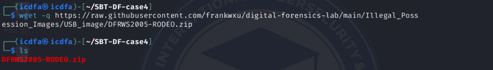

Figure 1 (E01). wget of DFRWS2005-RODEO.zip and ls showing the file in ~/SBT-DF-case4.

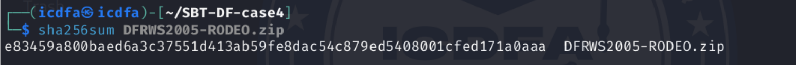

Figure 2 (E02). sha256sum DFRWS2005-RODEO.zip.

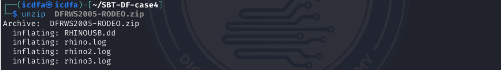

Figure 3 (E03). unzip DFRWS2005-RODEO.zip: RHINOUSB.dd, rhino.log, rhino2.log, rhino3.log.

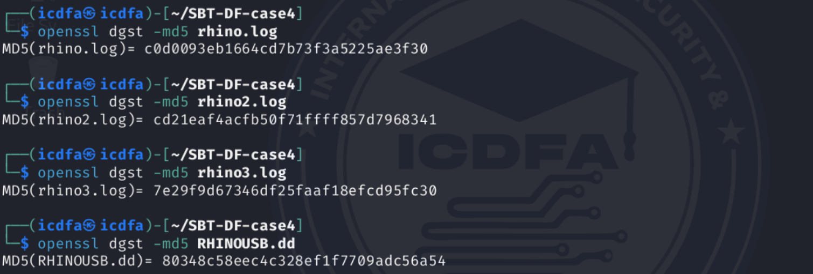

Figure 4 (E04). openssl dgst -md5 for the three logs and RHINOUSB.dd.

 

# 4. Method

Preservation: download, SHA-256 of the archive, extraction, MD5 of each extracted file, and a working copy of the disk image (Section 3).

Disk-image review: fdisk -l for the disk label, fsstat for FAT16 layout and cluster size, fls for directory records, and icat on the working copy to read the allocated files by inode (Q2).

Recovery: PhotoRec 7.2 run against the working copy with file-system type “Other” (FAT), output to recup_dir.1; recovered images viewed with GraphicsMagick display (Q3).

Hidden-content review: ExifTool metadata on a recovered JPEG; review of the recovered text; archive encryption and an authorised wordlist recovery against the supplied training archive only (Q4, Q6).

Network analysis: Wireshark Tools → Credentials, display filters (tcp.stream eq N, http contains “.jpg” / “.gif” / “.exe”), Follow TCP/HTTP Stream, Export Packet Bytes (Q5, Q7).

Object validation: magic-number inspection in the stream (FFD8 for JPEG, 504B0304 for ZIP, MZ for an executable), file(1) output, byte sizes and hashes (Q5–Q7).

Time normalisation: see Section 4.1.

Safeguards: no reconstructed executable was run; no recorded host was contacted. whois queried the ARIN registry only. A web search of the MD5 of rhino.exe was made without uploading the file (see Q7).

## 4.1 Time Normalisation

Wireshark showed absolute packet times (for example 2004-04-26 22:21:49.985023). Wireshark displays packet times in the analysis workstation’s local time unless View → Time Display Format is set to UTC, and the format used is not shown in the screenshots. ExifTool on the same workstation reports file times with a +01:00 offset (E15), so displayed packet times are treated as UTC+01:00 and converted to UTC by subtracting one hour; these converted values are labelled “(derived)”. Times taken from HTTP Date headers are GMT as recorded by the server and are used as UTC directly. Frame times shown only as seconds since capture start are reported as relative offsets and are not converted. This offset is an assumption and should be confirmed by switching the display to UTC.

 

# 5. Findings

## 5.1 Question 1 How did you preserve the case materials?

The archive was hashed (SHA-256 e83459a8…a0aaa, E02) before use and extracted into the case folder (E03). Each extracted file was given an MD5 value (E04) and its byte size is recorded in E10. A working copy of the disk image was made and used for icat and PhotoRec, and PhotoRec opened it read-only. The full source, size and hash set is in Section 3. Gaps: SHA-256 for the extracted files and the working copy, a read-only setting on the originals, and working copies of the captures.

## 5.2 Question 2 What does the USB disk image show before recovery?

Layout. fdisk -l reports RHINOUSB.dd as a 247.48 MiB disk of 259,506,176 bytes and 506,848 sectors of 512 bytes, disklabel type dos, disk identifier 0x00000000, and no partition entries (E05). fsstat shows “Sectors before file system: 0”, so a FAT16 file system begins at sector 0 of the image and no -o offset is required. Note that fdisk was used for the layout check; mmls was not run.

<table>
<tr><th>
Item
</th><th>
Value (fsstat, E06)
</th></tr>
<tr><td>
File system type / OEM name
</td><td>
FAT16 / mkdosfs
</td></tr>
<tr><td>
Volume ID / label
</td><td>
0x4092d9d1 / none in boot sector or root directory
</td></tr>
<tr><td>
Total range
</td><td>
Sectors 0–506847
</td></tr>
<tr><td>
Reserved / boot sector
</td><td>
Sector 0
</td></tr>
<tr><td>
FAT 0 / FAT 1
</td><td>
Sectors 1–248 / 249–496
</td></tr>
<tr><td>
Root directory
</td><td>
Sectors 497–528
</td></tr>
<tr><td>
Cluster area / non-clustered
</td><td>
Sectors 529–506840 / 506841–506847
</td></tr>
<tr><td>
Sector size / cluster size
</td><td>
512 bytes / 4,096 bytes (8 sectors)
</td></tr>
<tr><td>
Cluster range
</td><td>
2–63290
</td></tr>
<tr><td>
FAT chains listed
</td><td>
529–536 (8) → EOF; 537–544 (8) → EOF (two single-cluster files)
</td></tr>
</table>

Directory records. fls -o 0 lists two allocated files, gumbo1.txt (inode 4) and gumbo2.txt (inode 6), plus the virtual entries $MBR, $FAT1, $FAT2 and $OrphanFiles (E07). No deleted-entry marker (*) is shown for any file. icat on the working copy extracted inodes 4 and 6 (E08); the first lines show recipe text (SHRIMP AND TASSO GUMBO and SHRIMP AND ANDOUILLE SAUSAGE GUMBO; E08), of 2,815 and 1,293 bytes respectively (E10). These allocated files are unrelated to the rhino subject matter.

Limits of file-system metadata. The directory shows only what is currently allocated. The OEM name mkdosfs records the tool that wrote the boot sector; it is consistent with the file system having been (re)created, but it does not show when, and it does not by itself prove a reformat. Files deleted before that point leave no directory entries here, so their existence can only be tested by carving (Q3).

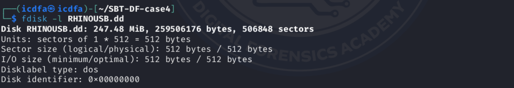

Figure 5 (E05). fdisk -l RHINOUSB.dd: 259,506,176 bytes, 506,848 sectors, dos label, no partition entries.

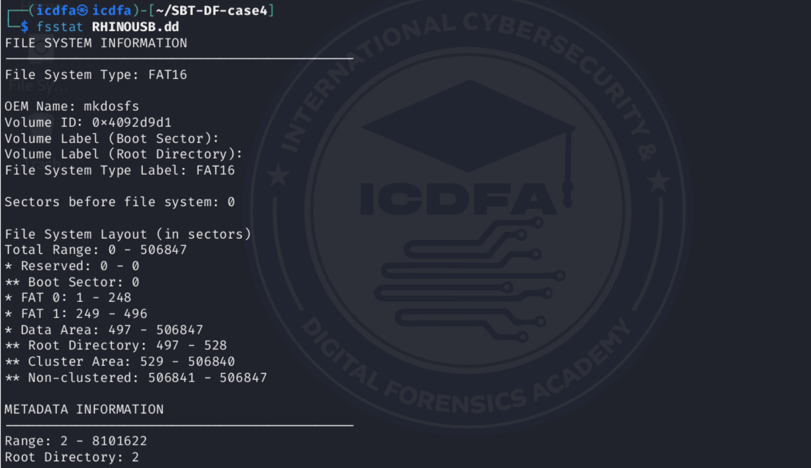

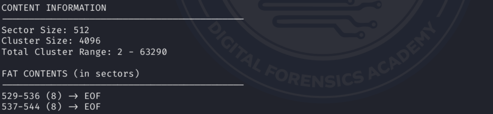

Figure 6 (E06). fsstat RHINOUSB.dd: FAT16, layout, cluster size 4096 and FAT chains.

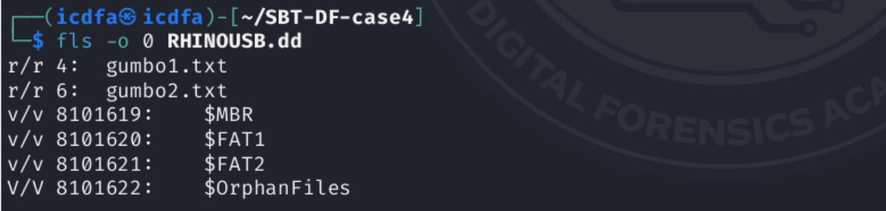

Figure 7 (E07). fls -o 0 RHINOUSB.dd: gumbo1.txt (inode 4), gumbo2.txt (inode 6) and virtual entries.

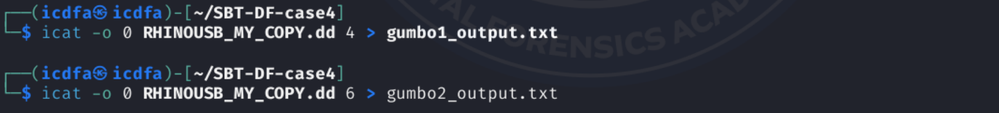

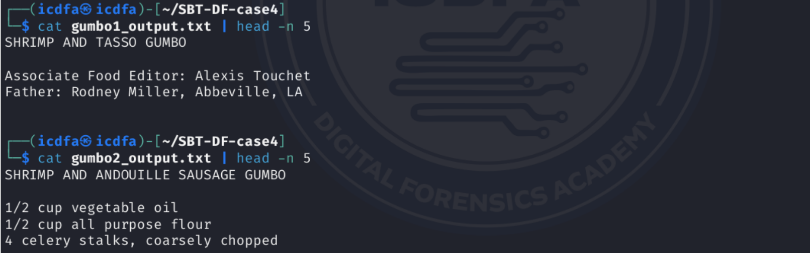

Figure 8 (E08). icat of inodes 4 and 6 from the working copy, and the first lines of each output.

## 5.3 Question 3  What deleted or recoverable files are supported?

Method and output. PhotoRec 7.2 was run on RHINOUSB_MY_COPY.dd (opened read-only), with the FAT16 partition selected and file-system type “Other” (E09). Output was written to the case folder (E10) and PhotoRec reported “132 files saved” (E11); the folder created is recup_dir.1 (E12). The recovery scope chosen (free space only or whole partition) is not visible in the screenshots.

Types recovered. The directory listing (E12) shows 7 JPEG files (f0104057, f0104249, f0105065, f0105873, f0106393, f0106409, f0335081), 2 GIF files (f0106865, f0106889), one Word document named f0335017_She_died_in_February_at_the_age_of_74.doc, report.xml, and the remainder as .txt files. Carved names such as f0106409 are PhotoRec sector-based names, not original file names, and carved files carry no original path or timestamps.

Visual check. Of the nine recovered image files, five were displayed (E13): f0105065.jpg and f0105873.jpg (captioned “ALLIGATOR HATCHING 2004”) and one further file whose name is not visible show alligators; f0106409.jpg shows an adult rhinoceros and a calf; and one further small image (name not visible) shows a rhinoceros. The other four image files were not shown in the supplied screenshots, so the number of rhinoceros images on the media is not established.

Hashes, duplicates and uniqueness. The recovered files were not hashed, so uniqueness and duplication cannot be asserted. Visually, f0106409.jpg resembles rhino2.jpg later extracted from contraband.zip (Q6); this is a visual resemblance, not a hash match.

Recovered text. A recovered text file (file name not visible in the screenshot) contains the passage reproduced below. It is quoted because it bears on concealment and on the “gnome” account (Q8):

Rhino pictures illegal? Makes me sick. I &quot;hid&quot; the photos... hehehehe. 
Apparently, if there are less than 10 photos, it&#x27;s no big deal. 
 
OK. Things are getting a little weird. I zapped the hard drive and then 
threw it into the Mississippi River. I&#x27;m gonna reformat my USB key after 
this entry, but try not to destroy the good stuff. I need to change the 
password on the gnome account that Jeremy gave me. I can probably just do 
that at Radio Shack.

This is text found on the media; it is a statement by an unidentified writer, undated in the output shown, and it does not itself prove who wrote it, when, or that its claims are true.

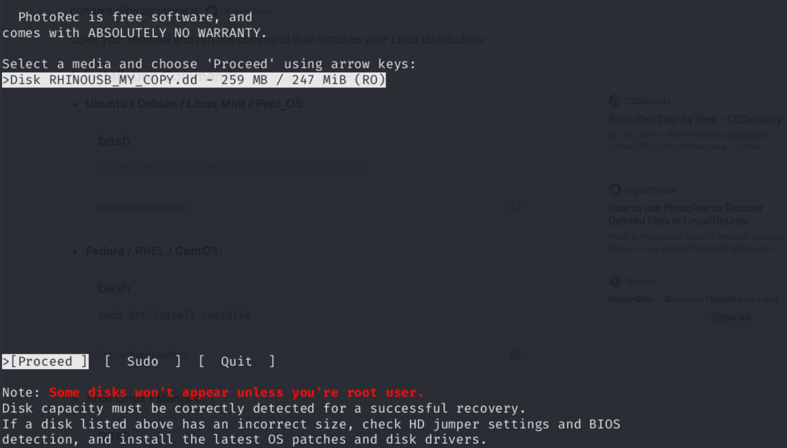

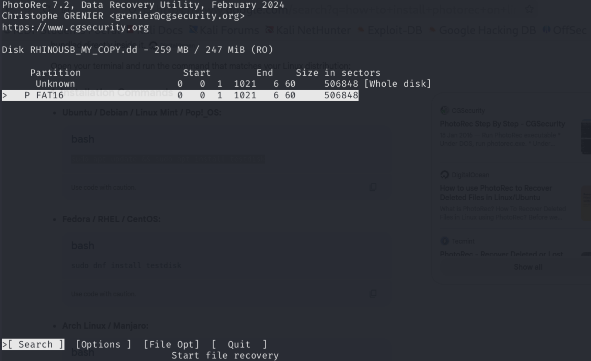

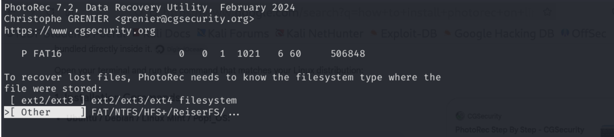

Figure 9 (E09). PhotoRec setup: media RHINOUSB_MY_COPY.dd (RO), FAT16 partition, file-system type “Other”.

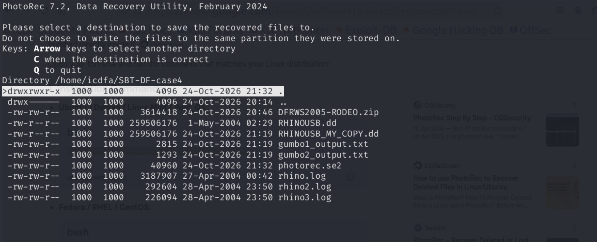

Figure 10 (E10). PhotoRec destination browser listing the case folder with byte sizes (zip 3,614,418; RHINOUSB.dd and working copy 259,506,176; rhino.log 3,187,907; rhino2.log 292,604; rhino3.log 226,094).

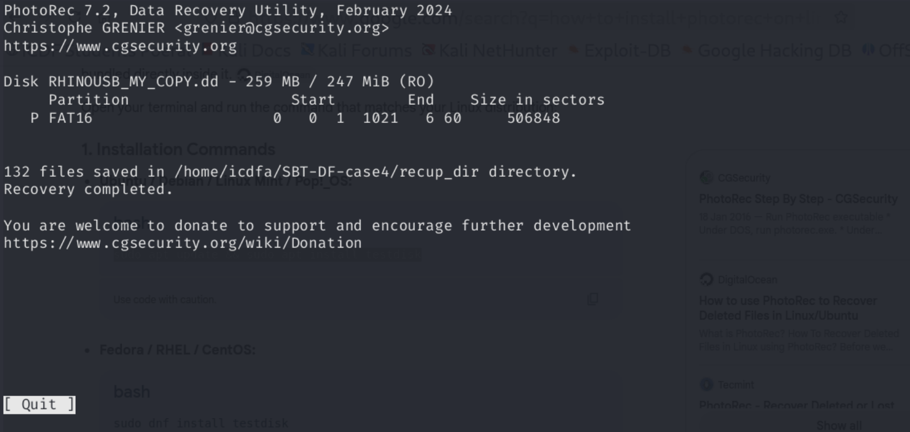

Figure 11 (E11). PhotoRec: 132 files saved in recup_dir; recovery completed.

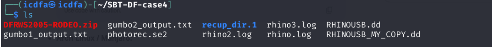

Figure 12 (E12). Case folder listing showing recup_dir.1 alongside the evidence files.

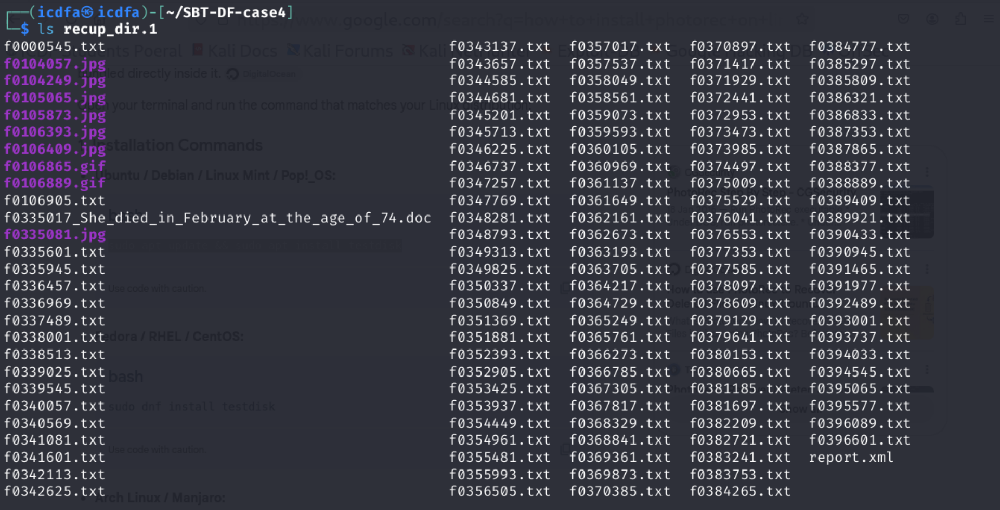

Figure 13 (E12). ls recup_dir.1: recovered .jpg, .gif, .doc, .txt files and report.xml.

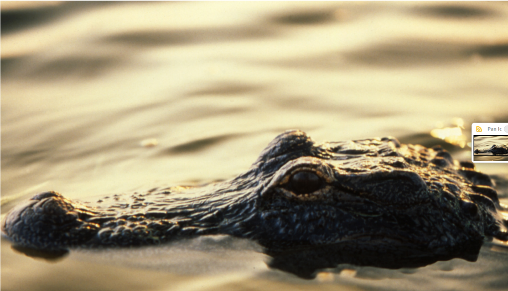

Figure 14 (E13). Recovered image alligator.

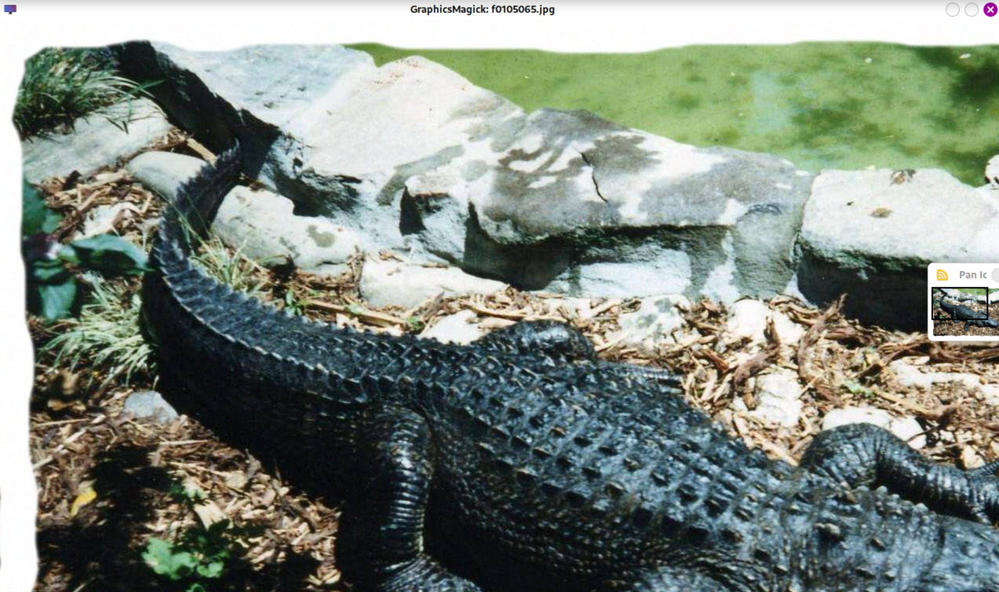

Figure 15 (E13). f0105065.jpg: alligator.

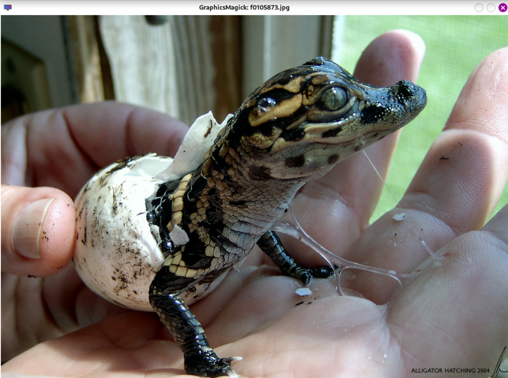

Figure 16 (E13). f0105873.jpg: alligator hatchling, caption “ALLIGATOR HATCHING 2004”.

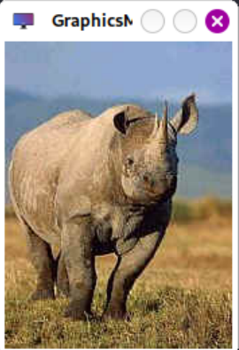

Figure 17 (E13). Recovered image (file name not visible): rhinoceros.

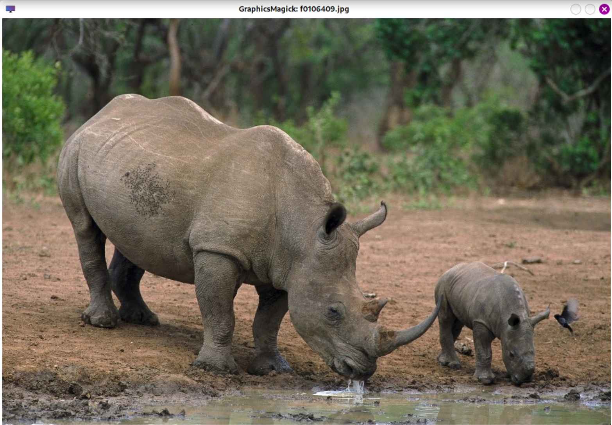

Figure 18 (E13). f0106409.jpg: rhinoceros and calf at water.

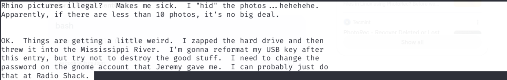

Figure 19 (E14). Recovered text file content (file name not visible).

 

## 5.4 Question 4  Is there evidence of hidden content in the recovered media?

Metadata review. ExifTool 13.55 on f0104057.jpg (run from a steg subfolder) shows a 96 kB baseline JFIF 1.01 JPEG of 528×792 pixels, with the comment “copyright 2000 philg@mit.edu” and file times of 2026-10-24 (the time the file was written by PhotoRec, not an original date) (E15). There is no camera, GPS or date information, and the comment does not link the file to the case.

Steganography testing. No output from a steganography detector or extraction tool is shown for any recovered image. Steganographic embedding is therefore not supported by the supplied output, and this report does not claim it.

Indications of concealment from other evidence. (a) The recovered text says the writer “hid” the photos and that the USB key would be reformatted (E14). (b) The FTP session of contraband.zip transferred an archive whose entry rhino2.jpg is password-protected (Q6). (c) The file system shows only two benign allocated files while carving recovered 132 others (Q2, Q3). Together these support a concealment-by-protection and concealment-by-deletion interpretation; they do not show data hidden inside an image.

What weakens the interpretation: the word “hid” is in quotation marks in the text and may be figurative; the carved files have no provenance; and no recovered file was compared by hash with any transferred file.

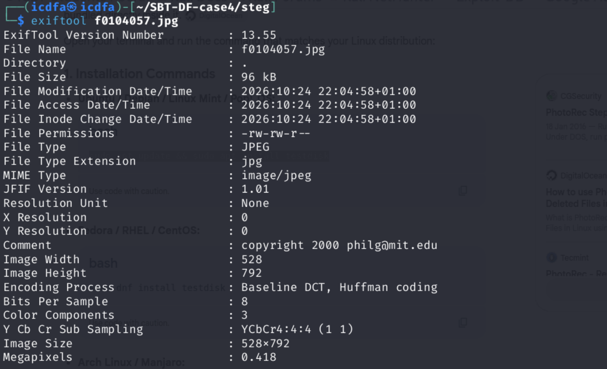

Figure 20 (E15). exiftool f0104057.jpg: JFIF 1.01, 528×792, Comment “copyright 2000 philg@mit.edu”.

## 5.5 Question 5  What does the FTP capture establish?

Wireshark Tools → Credentials on rhino.log lists three FTP logins by user “gnome”: username packets 1532, 1625 and 5633, with password packets 1536, 1629 and 5637 (E16, E20). The FTP server banner reads “220 cook FTP server ready.” and the server is 137.30.120.40; the client in the sessions examined is 137.30.122.253 (Ethernet source Apple_cc:57:92). The password is sent in clear text; it is redacted here and was not reused.

<table>
<tr><th>
Session
</th><th>
Packets / stream
</th><th>
Command and response
</th><th>
Direction
</th><th>
Size and object evidence
</th></tr>
<tr><td>
1
</td><td>
Login packets 1532/1536; control tcp.stream 69; data stream 71; data connection begins frame 1548 (22:21:49.985 displayed, 21:21:49.985 UTC derived)
</td><td>
STOR rhino1.jpg; 150 Opening BINARY mode data connection for rhino1.jpg; 226 Transfer complete; PORT 137,30,122,253,6,121 (client port 1657)
</td><td>
Client 137.30.122.253 → server 137.30.120.40 (upload)
</td><td>
221: 65,703 bytes in 1 file. Data stream begins FFD8 FFE0 (JPEG, JFIF); image opens as rhino1.jpg (rhinoceros)
</td></tr>
<tr><td>
2
</td><td>
Login packets 1625/1629 (credentials dialog only)
</td><td>
STOR command and stream number for this session are not visible in the supplied screenshots
</td><td>
Not shown
</td><td>
An image displayed as rhino3.jpg (rhinoceros and calf) was reconstructed from the stream the report attributes to this session; the stream reference is not shown
</td></tr>
<tr><td>
3
</td><td>
Login packets 5633/5637; control tcp.stream 305; data stream 307; data connection begins frames 5648–5652 (22:26:46.691 displayed, 21:26:46.691 UTC derived)
</td><td>
STOR contraband.zip; 150 Opening BINARY mode data connection; 226 Transfer complete; PORT 137,30,122,253,7,210 (client port 2002)
</td><td>
Client → server (upload)
</td><td>
221: 230,566 bytes in 1 file. Data stream begins 504B0304 (ZIP local file header)
</td></tr>
</table>

Interpretation. STOR is a client-to-server upload: the client stored these files on the server, and the server’s “226 Transfer complete” supports completion of each transfer from the server’s side. The PORT command identifies the client’s address and port for the data connection (active mode); it does not mean the client was receiving the file. Object boundaries are the data streams 71 and 307, with the JPEG and ZIP magic numbers at their starts, and the FTP summary byte counts match the objects named.

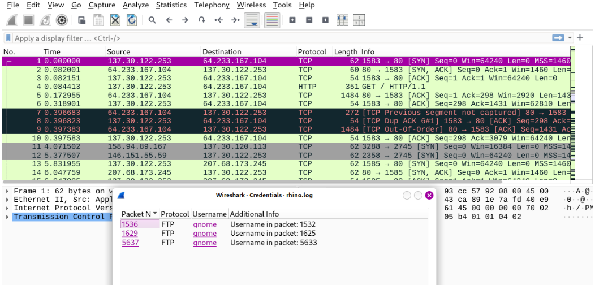

Figure 21 (E16). Wireshark Credentials dialog for rhino.log: user gnome in packets 1532, 1625 and 5633.

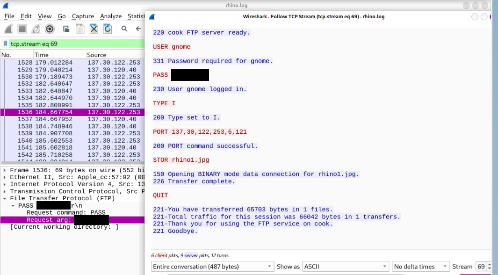

Figure 22 (E17). Follow TCP Stream, tcp.stream eq 69 (password redacted): USER gnome, STOR rhino1.jpg, 226 Transfer complete, 65,703 bytes.

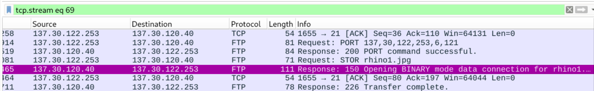

Figure 23 (E17). tcp.stream eq 69 packet list: PORT 137,30,122,253,6,121; STOR rhino1.jpg; 150 Opening BINARY mode; 226 Transfer complete.

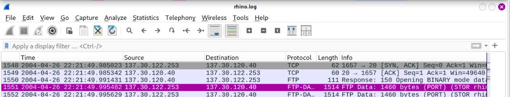

Figure 24 (E17). Data connection for the first transfer starting at frame 1548 (2004-04-26 22:21:49.985 as displayed).

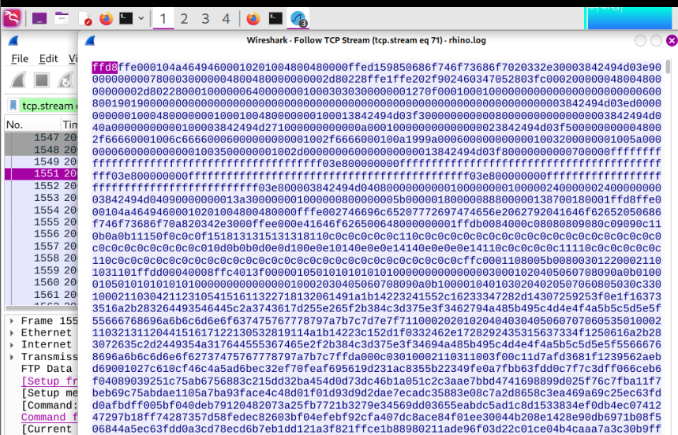

Figure 25 (E18). Follow TCP Stream, tcp.stream eq 71: data begins with the JPEG magic number FFD8 followed by a JFIF header.

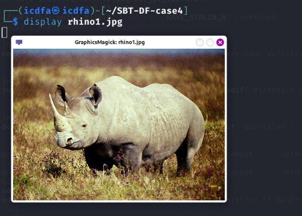

Figure 26 (E18). display rhino1.jpg: the reconstructed object opens as a rhinoceros photograph.

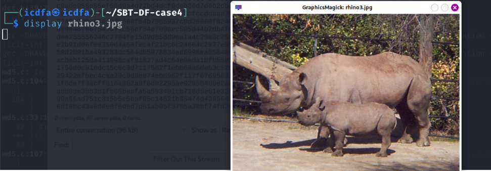

Figure 27 (E19). display rhino3.jpg: rhinoceros and calf (attributed in the working notes to the second FTP session).

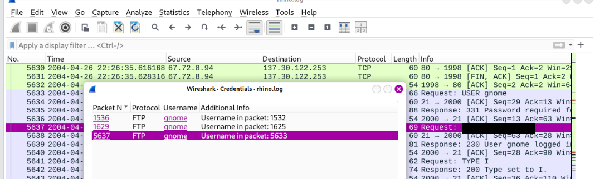

Figure 28 (E20). Credentials dialog and packet 5637 (password redacted), the third FTP login.

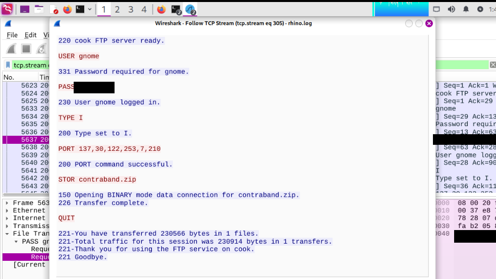

Figure 29 (E20). Follow TCP Stream, tcp.stream eq 305 (password redacted): STOR contraband.zip, 230,566 bytes.

## 5.6 Question 6 What does the protected archive analysis establish?

Completeness. The data stream tcp.stream eq 307 begins 504B0304, the ZIP local-file-header signature (E21), and the server summary reports 230,566 bytes transferred in one file. unzip on the exported archive opened it and listed one entry, rhino2.jpg, without a structural error (E22). The byte size of the exported file and its hash are not shown, so the match between the 230,566 transferred bytes and the exported file is not demonstrated.

Encryption. unzip prompts “[contraband.zip] rhino2.jpg password:”, which shows the entry is password-protected (E22).

Authorised recovery. Within the course lab and against the supplied training archive only, fcrackzip with the rockyou.txt wordlist was run and reported a password (redacted in E23). The password was then used once to extract rhino2.jpg (E24). It was not applied to any other file, account or host.

Content. rhino2.jpg opens as a photograph of an adult rhinoceros and a calf at water (E24). It looks like carved file f0106409.jpg (E13), but no hash comparison is shown, so equality is not established.

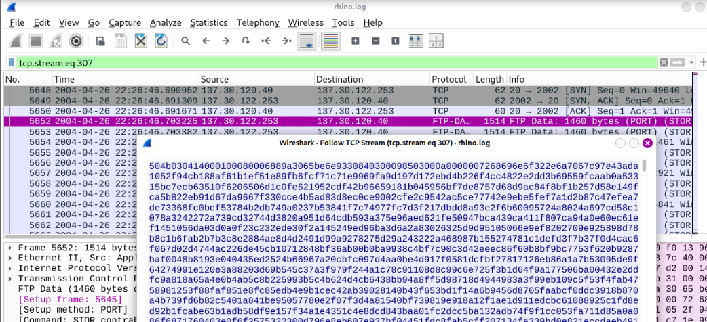

Figure 30 (E21). Data stream tcp.stream eq 307: first bytes 504B0304 (ZIP), data connection to client port 2002 from frame 5648 (2004-04-26 22:26:46.69 as displayed).

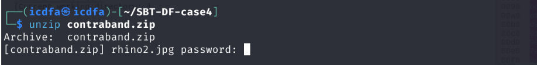

Figure 31 (E22). unzip contraband.zip: password prompt for rhino2.jpg.

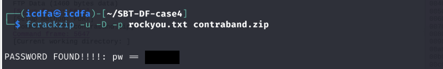

Figure 32 (E23). fcrackzip -u -D -p rockyou.txt contraband.zip: password found (value redacted).

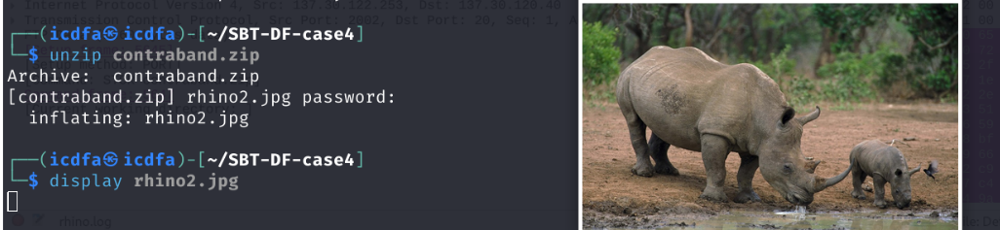

Figure 33 (E24). unzip then display rhino2.jpg: rhinoceros and calf.

 

## 5.7 Question 7 What does the HTTP capture establish?

Endpoints. In rhino2.log and rhino3.log the client is 137.30.123.234 (Ethernet source Apple_cc:57:92, the same network-card name as the FTP client in rhino.log) and the web server is 137.30.120.37, which serves Host: www.cs.uno.edu and identifies as Apache/1.3.29 (Unix) (E27, E29, E32). The client sends User-Agent Mozilla/4.0 (compatible; MSIE 6.0; Windows NT 5.1; .NET CLR 1.1.4322). whois on 137.30.123.234 returns the ARIN allocation 137.30.0.0–137.30.255.255, organisation University of New Orleans (E26).

<table>
<tr><th>
Capture
</th><th>
Packet / stream
</th><th>
Request and response
</th><th>
Observed detail
</th></tr>
<tr><td>
rhino2.log
</td><td>
http contains “.jpg”: frame 49 (+7.892558 s) request; tcp.stream 1: frame 215 (+8.094061 s) response
</td><td>
GET /~gnome/rhino4.jpg HTTP/1.1; HTTP/1.1 200 OK (JPEG JFIF image), 108 reassembled TCP segments
</td><td>
Client 137.30.123.234 → server 137.30.120.37; displayed as a painting of a rhinoceros (artwork, not a photograph)
</td></tr>
<tr><td>
rhino2.log
</td><td>
http contains “.gif”: frame 217 (+14.008741 s); tcp.stream 2
</td><td>
GET /~gnome/rhino5.gif HTTP/1.1
</td><td>
Displayed as a pencil sketch of a rhinoceros. Server Date header in the stream: Wed, 28 Apr 2004 21:07:26 GMT
</td></tr>
<tr><td>
rhino3.log
</td><td>
http contains “.exe”: frame 10 (+7.043566 s); frames 59 and 85
</td><td>
GET /search?hl=en…q=rhino.exe (Google 64.233.167.99); two further GET /groups?q=rhino.exe requests (216.239.51.99)
</td><td>
The client searched for “rhino.exe” before requesting it from the server
</td></tr>
<tr><td>
rhino3.log
</td><td>
frame 110 (+42.151630 s) request; tcp.stream 3; frame 274 (+43.022791 s) response
</td><td>
GET /~gnome/rhino.exe HTTP/1.1; HTTP/1.1 200 OK, Content-Type application/octet-stream, Content-Length 145920
</td><td>
104 reassembled TCP segments, 145,920 bytes; Date: Wed, 28 Apr 2004 21:15:13 GMT; payload begins MZ (“This program cannot be run in DOS mode”)
</td></tr>
</table>

Object extraction and validation. The 145,920-byte payload was exported using Export Packet Bytes (E33). ls -l confirms the exported file rhino.exe is 145,920 bytes, matching Content-Length, and file reports “PE32 executable (console) Intel 80386, for MS Windows, 3 sections” (E34). Its MD5 is d62d9989535c4c8db14e50b58c9f25a0 (E35). The executable was not run.

Hash lookup. The MD5 was searched on Google (no file was uploaded). The top result is a NIST CFReDS document for the DFRWS 2005 Rodeo challenge whose snippet contains the same MD5 next to text referring to Microsoft DiskPart (E36). This suggests rhino.exe may be a copy of the Windows DiskPart utility, but it rests on a search snippet and was not confirmed by opening the document or comparing against a verified hash set, so it is a lead, not a finding. The brief prohibits submitting material to public scanners; a hash string search does not upload the file, but this should be confirmed as acceptable.

What HTTP does and does not show. The captures show requests and complete 200 OK responses for rhino4.jpg, rhino5.gif and rhino.exe from the /~gnome/ area of the server. They do not show who was at the client, why the client searched for rhino.exe, or whether the executable was run.

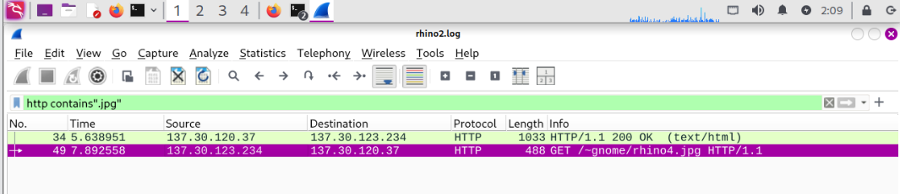

Figure 34 (E25). rhino2.log filtered with http contains “.jpg”: frame 34 (200 OK, text/html) and frame 49 (GET /~gnome/rhino4.jpg).

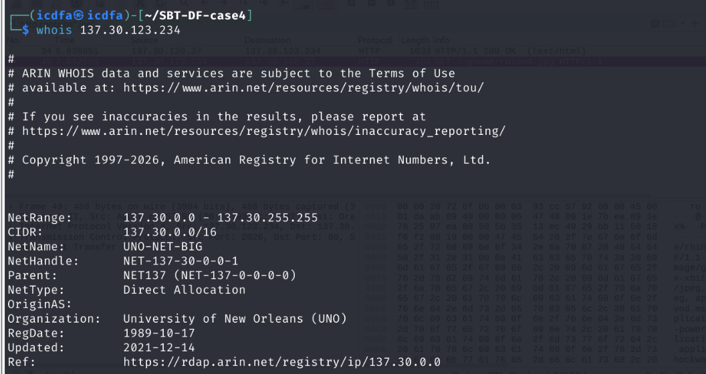

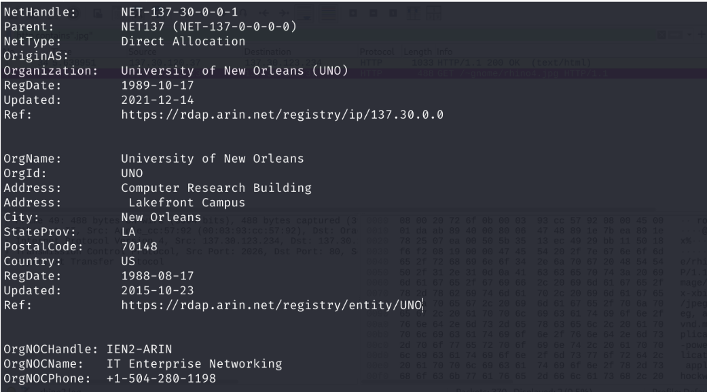

Figure 35 (E26). whois 137.30.123.234: University of New Orleans, 137.30.0.0/16.

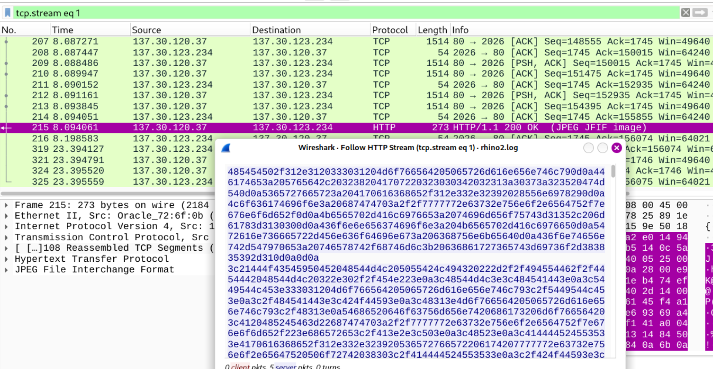

Figure 36 (E27). tcp.stream eq 1 in rhino2.log: frame 215, HTTP/1.1 200 OK (JPEG JFIF image), 108 reassembled segments.

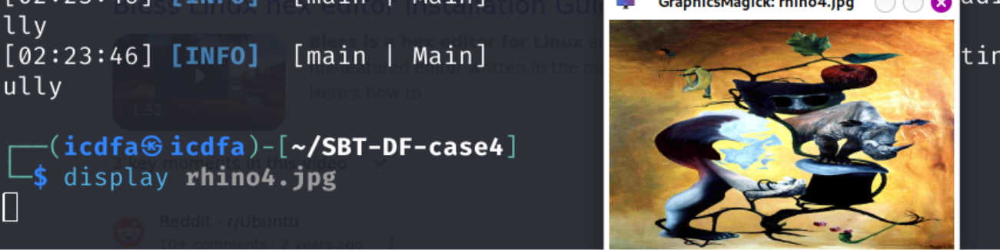

Figure 37 (E28). display rhino4.jpg: a painting featuring a rhinoceros.

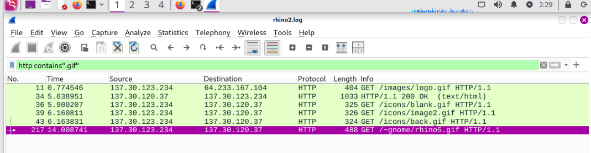

Figure 38 (E29). rhino2.log filtered with http contains “.gif”: frame 217, GET /~gnome/rhino5.gif.

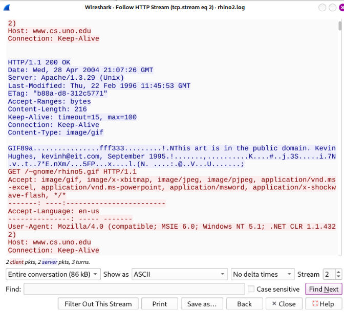

Figure 39 (E29). Follow HTTP Stream, tcp.stream eq 2: server headers (Apache/1.3.29) and the GET for /~gnome/rhino5.gif.

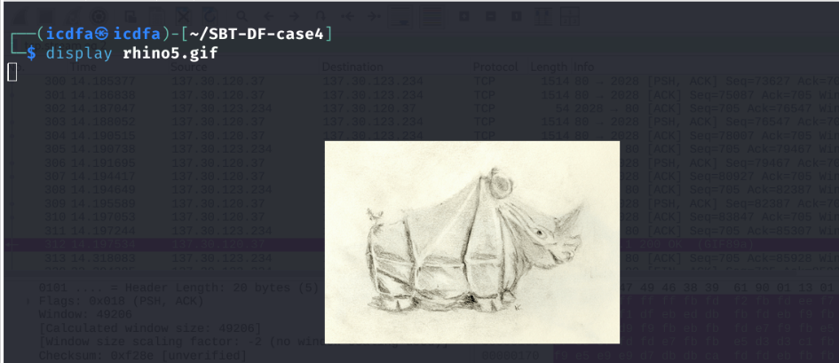

Figure 40 (E30). display rhino5.gif: a pencil sketch of a rhinoceros.

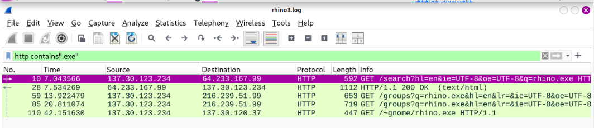

Figure 41 (E31). rhino3.log filtered with http contains “.exe”: search for rhino.exe (frames 10, 59, 85) and GET /~gnome/rhino.exe (frame 110).

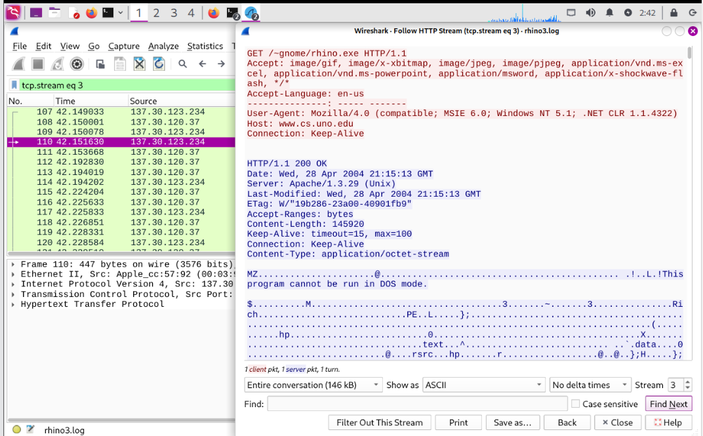

Figure 42 (E32). Follow HTTP Stream, tcp.stream eq 3: GET /~gnome/rhino.exe; 200 OK, Content-Length 145920, application/octet-stream, MZ header.

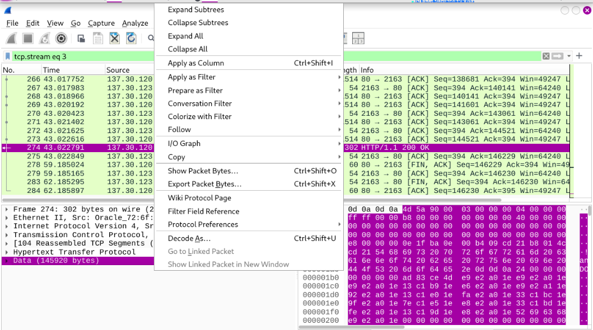

Figure 43 (E33). Frame 274: 104 reassembled TCP segments, Data 145,920 bytes; Export Packet Bytes selected.

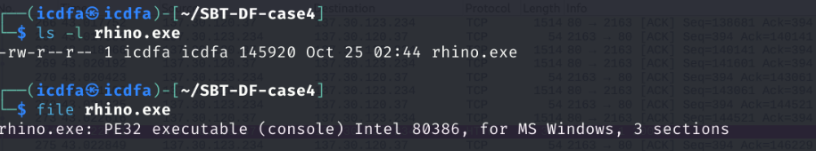

Figure 44 (E34). ls -l and file on the exported rhino.exe: 145,920 bytes; PE32 executable (console).

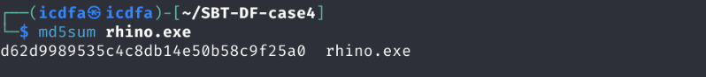

Figure 45 (E35). md5sum rhino.exe.

Figure 46 (E36). Google search of the MD5: NIST CFReDS DFRWS 2005 Rodeo challenge result (search snippet only).

 

## 5.8 Question 8 — What conclusion can you defend?

A defensible conclusion is the one in Section 2: the supplied artefacts support (1) a USB file system that now lists only two benign files but yielded 132 carved files, including images of alligators and rhinoceroses and a text file stating intent to hide pictures and destroy evidence; (2) FTP uploads of a rhinoceros image and a password-protected archive containing a rhinoceros image from 137.30.122.253 using the account “gnome”; and (3) HTTP retrieval of rhino-related images and a Windows executable from /~gnome/ by a client sharing the same Ethernet address. The timeline is in Section 6; limitations and alternative explanations are in Section 7.

 

# 6. Timeline and Correlation

All times are UTC. “(derived)” marks a Wireshark-displayed time converted by subtracting one hour (Section 4.1). Relative offsets are seconds from the start of the named capture and are not converted.

<table>
<tr><th>
Stage
</th><th>
UTC timestamp
</th><th>
Ev. ID
</th><th>
Source artefact
</th><th>
Observed fact
</th><th>
Interpretation and limit
</th></tr>
<tr><td>
Media preservation
</td><td>
2026-10-24 19:46 (derived from file time 20:46 at +01:00)
</td><td>
E10
</td><td>
DFRWS2005-RODEO.zip
</td><td>
Zip present, 3,614,418 bytes; SHA-256 recorded
</td><td>
File time reflects download; hash recorded for the archive only
</td></tr>
<tr><td>
Media preservation
</td><td>
2026-10-24 20:19 (derived from 21:19)
</td><td>
E10
</td><td>
RHINOUSB_MY_COPY.dd
</td><td>
Working copy exists, same size as original
</td><td>
No hash of the copy recorded
</td></tr>
<tr><td>
FTP transfer activity
</td><td>
2004-04-26 21:21:49.985 (derived)
</td><td>
E17, E18
</td><td>
rhino.log frame 1548; streams 69, 71
</td><td>
Data connection opened for STOR rhino1.jpg; 65,703 bytes; 226 Transfer complete
</td><td>
Upload by client 137.30.122.253 as user gnome; shows transfer, not who operated the client
</td></tr>
<tr><td>
FTP transfer activity
</td><td>
2004-04-26 21:26:46.691 (derived)
</td><td>
E20, E21
</td><td>
rhino.log frames 5648–5652; streams 305, 307
</td><td>
Data connection opened for STOR contraband.zip; 230,566 bytes; ZIP header
</td><td>
Upload of an encrypted archive; completion supported by 226 from the server
</td></tr>
<tr><td>
HTTP transfer activity
</td><td>
2004-04-28 21:07:26 GMT (header)
</td><td>
E29
</td><td>
rhino2.log stream 2
</td><td>
Server Date header; GET /~gnome/rhino5.gif at +14.01 s; GET rhino4.jpg at +7.89 s (frame 49)
</td><td>
Header time anchors the session to about 21:07 GMT; frame times are relative only
</td></tr>
<tr><td>
HTTP transfer activity
</td><td>
2004-04-28 21:15:13 GMT (header)
</td><td>
E31–E33
</td><td>
rhino3.log frames 10, 110, 274
</td><td>
Search for rhino.exe at +7.04 s; GET rhino.exe at +42.15 s; 200 OK 145,920 bytes at +43.02 s
</td><td>
Executable retrieved after a search for its name; not executed
</td></tr>
<tr><td>
Disk image / file-system review
</td><td>
2004-05-01 02:29 (time of RHINOUSB.dd as listed; zone not stated, not converted)
</td><td>
E10
</td><td>
RHINOUSB.dd file time
</td><td>
Original image file time in the case folder
</td><td>
Meaning unknown (image creation or archive time); it follows the network events but is not shown to be a reformat time
</td></tr>
<tr><td>
Recovered or hidden content
</td><td>
2026-10-24 20:32 (derived from 21:32)
</td><td>
E11, E12, E14
</td><td>
PhotoRec output recup_dir.1
</td><td>
132 files recovered; images, .doc and text, including the statement about hiding photos and reformatting the USB key
</td><td>
Carved files have no original names or times; the text is undated
</td></tr>
<tr><td>
Recovered or hidden content
</td><td>
Analysis session, 2026-10-24/25
</td><td>
E22–E24
</td><td>
contraband.zip
</td><td>
Password prompt; authorised recovery; rhino2.jpg extracted
</td><td>
Shows protection; recovered content looks like f0106409.jpg but is not hash-matched
</td></tr>
<tr><td>
Corroborated conclusion
</td><td>
—
</td><td>
E14, E17, E20, E31
</td><td>
Correlation
</td><td>
“gnome” appears in the recovered text, the FTP login and the /~gnome/ web path; one Ethernet address on both client IPs
</td><td>
Corroborates a relationship between the account, the device and the text; does not prove the author, completion on the USB, or a named person
</td></tr>
</table>

## 6.1 Correlation Summary

<table>
<tr><th>
Proposed relationship
</th><th>
Corroborating artefacts
</th><th>
Conflicting or missing evidence
</th><th>
Assessment
</th></tr>
<tr><td>
The same device carried out the FTP uploads and the HTTP requests
</td><td>
Ethernet source Apple_cc:57:92 on rhino.log (client 137.30.122.253), rhino2.log and rhino3.log (client 137.30.123.234)
</td><td>
Client IP changed between captures; full MAC value taken from partial text in the whois screenshot (E26)
</td><td>
Supported (moderate)
</td></tr>
<tr><td>
The “gnome” account links the USB text, FTP and web content
</td><td>
“gnome account that Jeremy gave me” (E14); FTP user gnome (E16); /~gnome/ web path (E25, E31)
</td><td>
The text says the account was given to the writer, so use by others is possible; no direct file match
</td><td>
Corroborates a relationship only
</td></tr>
<tr><td>
Rhino images were sent to the server
</td><td>
STOR rhino1.jpg (E17); contraband.zip containing rhino2.jpg (E20–E24)
</td><td>
Counts of distinct images and hash equality with the carved files not tested
</td><td>
Transfer supported; threshold not established
</td></tr>
<tr><td>
Images were hidden
</td><td>
Password-protected archive; text saying “hid”; carved files absent from the directory
</td><td>
No steganography detector output; “hid” is in quotation marks
</td><td>
Concealment indicated; image-level steganography not shown
</td></tr>
<tr><td>
The USB was reformatted to destroy evidence
</td><td>
Text states the intent; only two files allocated; mkdosfs OEM name
</td><td>
No reformat time; text undated
</td><td>
Consistent, not proven
</td></tr>
</table>

 

# 7. Conclusion

Observed facts: the disk image is a whole-disk FAT16 volume listing two recipe files; PhotoRec recovered 132 files from the working copy, including nine image files and a text file about hiding and destroying material; rhino.log records logins as “gnome” and uploads of rhino1.jpg and contraband.zip, completed per the server; rhino2.log and rhino3.log record requests for rhino4.jpg, rhino5.gif and rhino.exe from /~gnome/ by a client with the same Ethernet address as the FTP client. Inferences: these are consistent with a device using one account for both uploads and web retrieval and with an effort to protect and conceal rhino images. Confidence is moderate for the device and account findings, low for any person-level or possession-threshold conclusion.

# Appendix A — Evidence Log

<table>
<tr><th>
ID
</th><th>
Tool and method
</th><th>
Source record, stream or path
</th><th>
Observed fact
</th><th>
Figure
</th></tr>
<tr><td>
E01
</td><td>
wget; ls
</td><td>
DFRWS2005-RODEO.zip, ~/SBT-DF-case4
</td><td>
Archive downloaded
</td><td>
Fig. 1
</td></tr>
<tr><td>
E02
</td><td>
sha256sum
</td><td>
DFRWS2005-RODEO.zip
</td><td>
SHA-256 e83459a8…a0aaa
</td><td>
Fig. 2
</td></tr>
<tr><td>
E03
</td><td>
unzip
</td><td>
DFRWS2005-RODEO.zip
</td><td>
Extracted RHINOUSB.dd, rhino.log, rhino2.log, rhino3.log
</td><td>
Fig. 3
</td></tr>
<tr><td>
E04
</td><td>
openssl dgst -md5
</td><td>
Four extracted files
</td><td>
MD5 values recorded
</td><td>
Fig. 4
</td></tr>
<tr><td>
E05
</td><td>
fdisk -l
</td><td>
RHINOUSB.dd
</td><td>
259,506,176 bytes; dos label; no partitions
</td><td>
Fig. 5
</td></tr>
<tr><td>
E06
</td><td>
fsstat
</td><td>
RHINOUSB.dd
</td><td>
FAT16; cluster 4096; layout
</td><td>
Fig. 6
</td></tr>
<tr><td>
E07
</td><td>
fls -o 0
</td><td>
RHINOUSB.dd
</td><td>
gumbo1.txt (4), gumbo2.txt (6)
</td><td>
Fig. 7
</td></tr>
<tr><td>
E08
</td><td>
icat; cat
</td><td>
RHINOUSB_MY_COPY.dd inodes 4, 6
</td><td>
Recipe text
</td><td>
Fig. 8
</td></tr>
<tr><td>
E09
</td><td>
PhotoRec 7.2
</td><td>
RHINOUSB_MY_COPY.dd (RO)
</td><td>
FAT16, type Other
</td><td>
Fig. 9
</td></tr>
<tr><td>
E10
</td><td>
PhotoRec directory browser
</td><td>
~/SBT-DF-case4
</td><td>
Byte sizes and file times
</td><td>
Fig. 10
</td></tr>
<tr><td>
E11
</td><td>
PhotoRec
</td><td>
recup_dir
</td><td>
132 files saved
</td><td>
Fig. 11
</td></tr>
<tr><td>
E12
</td><td>
ls
</td><td>
recup_dir.1
</td><td>
jpg, gif, doc, txt, report.xml
</td><td>
Fig. 12, Fig. 13
</td></tr>
<tr><td>
E13
</td><td>
display (GraphicsMagick)
</td><td>
Recovered images
</td><td>
Alligator and rhinoceros images
</td><td>
Fig. 14, Fig. 15, Fig. 16, Fig. 17, Fig. 18
</td></tr>
<tr><td>
E14
</td><td>
Text view
</td><td>
Recovered text file
</td><td>
Statements about hiding photos and reformatting
</td><td>
Fig. 19
</td></tr>
<tr><td>
E15
</td><td>
exiftool 13.55
</td><td>
f0104057.jpg
</td><td>
Comment: copyright 2000 philg@mit.edu
</td><td>
Fig. 20
</td></tr>
<tr><td>
E16
</td><td>
Wireshark Credentials
</td><td>
rhino.log packets 1532/1536, 1625/1629, 5633/5637
</td><td>
Three FTP logins as gnome
</td><td>
Fig. 21
</td></tr>
<tr><td>
E17
</td><td>
Follow TCP Stream
</td><td>
rhino.log stream 69
</td><td>
STOR rhino1.jpg, 65,703 bytes, frame 1548
</td><td>
Fig. 22, Fig. 23, Fig. 24
</td></tr>
<tr><td>
E18
</td><td>
Follow TCP Stream; display
</td><td>
rhino.log stream 71
</td><td>
FFD8 JPEG; rhino1.jpg
</td><td>
Fig. 25, Fig. 26
</td></tr>
<tr><td>
E19
</td><td>
display
</td><td>
Second-session object
</td><td>
rhino3.jpg (rhinoceros and calf)
</td><td>
Fig. 27
</td></tr>
<tr><td>
E20
</td><td>
Follow TCP Stream
</td><td>
rhino.log stream 305
</td><td>
STOR contraband.zip, 230,566 bytes
</td><td>
Fig. 28, Fig. 29
</td></tr>
<tr><td>
E21
</td><td>
Follow TCP Stream
</td><td>
rhino.log stream 307
</td><td>
504B0304 ZIP header
</td><td>
Fig. 30
</td></tr>
<tr><td>
E22
</td><td>
unzip
</td><td>
contraband.zip
</td><td>
Password prompt for rhino2.jpg
</td><td>
Fig. 31
</td></tr>
<tr><td>
E23
</td><td>
fcrackzip -u -D -p rockyou.txt
</td><td>
contraband.zip
</td><td>
Password found (redacted)
</td><td>
Fig. 32
</td></tr>
<tr><td>
E24
</td><td>
unzip; display
</td><td>
contraband.zip
</td><td>
rhino2.jpg
</td><td>
Fig. 33
</td></tr>
<tr><td>
E25
</td><td>
Wireshark filter
</td><td>
rhino2.log
</td><td>
http contains .jpg: frames 34, 49
</td><td>
Fig. 34
</td></tr>
<tr><td>
E26
</td><td>
whois
</td><td>
137.30.123.234
</td><td>
University of New Orleans, 137.30.0.0/16
</td><td>
Fig. 35
</td></tr>
<tr><td>
E27
</td><td>
Follow stream
</td><td>
rhino2.log stream 1, frame 215
</td><td>
200 OK JPEG JFIF, 108 segments
</td><td>
Fig. 36
</td></tr>
<tr><td>
E28
</td><td>
display
</td><td>
rhino4.jpg
</td><td>
Painting of a rhinoceros
</td><td>
Fig. 37
</td></tr>
<tr><td>
E29
</td><td>
Wireshark filter; Follow stream
</td><td>
rhino2.log frame 217, stream 2
</td><td>
GET /~gnome/rhino5.gif
</td><td>
Fig. 38, Fig. 39
</td></tr>
<tr><td>
E30
</td><td>
display
</td><td>
rhino5.gif
</td><td>
Pencil sketch of a rhinoceros
</td><td>
Fig. 40
</td></tr>
<tr><td>
E31
</td><td>
Wireshark filter
</td><td>
rhino3.log frames 10, 59, 85, 110
</td><td>
Search then GET /~gnome/rhino.exe
</td><td>
Fig. 41
</td></tr>
<tr><td>
E32
</td><td>
Follow stream
</td><td>
rhino3.log stream 3
</td><td>
200 OK, 145,920 bytes, MZ
</td><td>
Fig. 42
</td></tr>
<tr><td>
E33
</td><td>
Export Packet Bytes
</td><td>
rhino3.log frame 274
</td><td>
104 segments, 145,920 bytes
</td><td>
Fig. 43
</td></tr>
<tr><td>
E34
</td><td>
ls -l; file
</td><td>
rhino.exe
</td><td>
PE32 console executable
</td><td>
Fig. 44
</td></tr>
<tr><td>
E35
</td><td>
md5sum
</td><td>
rhino.exe
</td><td>
MD5 d62d9989…f25a0
</td><td>
Fig. 45
</td></tr>
<tr><td>
E36
</td><td>
Web search of hash
</td><td>
NIST CFReDS snippet
</td><td>
Associates the MD5 with DiskPart text (lead only)
</td><td>
Fig. 46
</td></tr>
</table>
